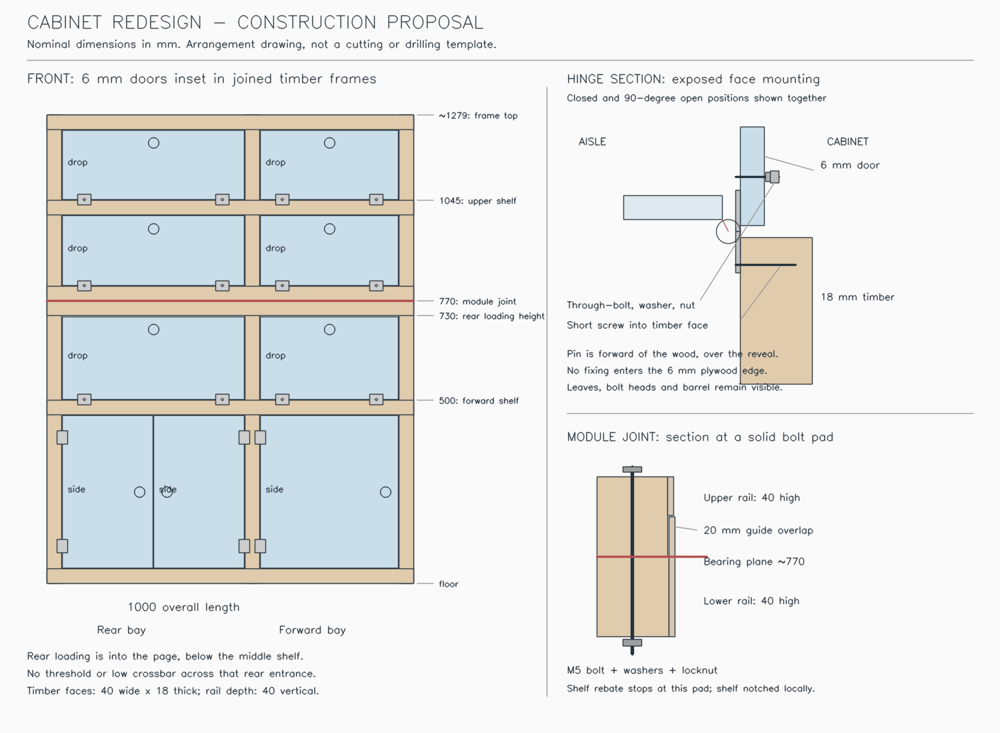

# New cabinet: construction proposal

8 November 2026. The current replacement uses 9mm supporting plywood panels and local timber cleats, with the
existing 40 × 18mm front-frame stock and 90 × 18mm arch bridge. Earlier frame studies below are historical;
use the current model and [cabinet model notes](../cad-model.md) for implemented dimensions. Hardware envelopes
remain provisional.

Follow-up: [mixed-section frame and lighter-skin weight study](cabinet-weight-refinement.md). Its approximately
15kg target is conditional: the proposed 30 × 18mm timber was not verified as purchasable NZ stock and is withdrawn
as a sourced recommendation. The drawing and all-40mm allocation below remain the comparison baseline.

## Panel-and-cleat replacement, 8 November 2026

The approved replacement uses the existing Bunnings 9mm Tigerply Okoume for supporting end panels and the centre
divider. These replace the earlier 3mm skins and transverse/rear timber ladders. Full-profile panels carry five
6mm shelves on face-mounted 40 × 18mm cleats. The front frame, local hardware backing and side joining rails
retain the existing timber stock; there is no independent back frame or internal shelf post.

The lower middle panel clears the arch and bears through blocks on the retained 90 × 18mm bridge. Its ends have
rear-jamb and cab-end panel support. The rear chair-loading opening, two modules, 20mm guides, side-only bolts,
nine doors and the four visibility filters remain. Whole-cabinet strength and weight are not established by
removing the skeleton; the current CAD and cut list supersede the nominal allocations below.

This adapts documented plywood-divider construction from
[FarOutRide](https://faroutride.com/overhead-storage-cabinet/),
[VanConverts](https://vanconverts.com/lightweight-upper-cabinets-camper-van/), and the plywood-and-cleat/fillet
principles in [Gougeon Brothers chapter 26](https://www.westsystem.com/app/uploads/2022/10/GougeonBook-061205-1.pdf).
Their examples establish construction methods, not the capacity of this cabinet or permission to bond to van lining.

The following sections record earlier, superseded frame arrangements.

## Hardware support and simpler corner, 8 November 2026

The current corner uses one back-frame plane across the full cabinet length per module. Posts occur only at
the end frames and middle partition. The separate posts inside the rear shelf bay, shaped 140mm return boards
and short stepped-return rails are removed. Longitudinal rails and the wheel-arch bridge land directly on the
actual end-frame posts. The bridge supports the middle posts above the wheel arch. Use glued dowelled rail/post
joints, as described in the casework reference below, rather than treating touching solids as finished joinery.

The timber plane is deliberately inboard to clear the rear pillar. The plywood is not: shelves and skins retain
their full scribed van-fitting contours and bonded side-panel connections. Shelf notches are confined to perimeter
framing and hardware; there is no upright through the interior of a shelf. The older globally shallow proposal
below incorrectly moved the plywood inward too; that is not the current arrangement. The return-stock controls
and material role remain retired. The earlier corner proposals below are superseded.

Each catch now mounts beneath a square-cut 40 × 40 × 18mm block fixed broad-face to its front header. Blocks share
the existing 40 × 18mm frame stock. Two 6g × 40mm screws and glue attach each block; catch base screws enter its
18mm thickness. Keepers through-bolt to the door back. Fixed hinge leaves through-bolt to the 18mm front frame;
local shelf notches preserve full timber at their fixing positions and clear backing nuts. Runtime geometry checks
require timber support before drilling, rather than merely placing hardware beside an opening.

Sourcing checked online: [Taskmaster catches include screws](https://www.bunnings.co.nz/taskmaster-zinc-double-roller-catch-4-pack_p0035579);
[Champion M3 × 25 screw/nut sets](https://www.mitre10.co.nz/shop/champion-machine-screws-m3-x-25/p/226173)
are $5 per 20-pack; [Zenith 6g × 40 screws](https://www.bunnings.co.nz/zenith-6g-x-40mm-zinc-plated-longthread-timber-screws-100-pack_p2434142)
are $12.54 per 100-pack. M3 × 12 pan screws are listed by
[Bearing & Engineering](https://www.bearingandengineering.co.nz/shop/Fasteners/stainless-fasteners/stainless-machine-screws/MACHINE%2BSCREW%2BM3%2Bx%2B12%2BPAN%2BSTAINLESS.html).
Short bolt/nut sets and backing washers remain unpriced in the BOM. Actual leaf holes/swage and catch dimensions
are not published in the selected retail listings: these models are mounting envelopes, not drilling templates.

## Scribed plywood correction, 8 November 2026

The fitted-back correction below still incorrectly constrained the plywood to the timber's back planes. The
current model separates them. Timber remains simple and inboard. Middle/end skins and all five shelves now use
jigsaw outlines from the actual side/pillars, wheel arch and finished ceiling, extruded at constant 3mm/6mm stock
thickness. Timber ceiling clearance does not shorten the skins. Main shelf depths at the saved levels are about
415mm, 404mm and 371mm, with the actual pillar/corner outlines.

Inset wall-facing back panels and their narrow skin returns are removed so they cannot block shelf extension;
the van side closes the cabinet's back. The middle/end skins and all frame members remain. Previous continuous
back-sheet shear assumptions are superseded; this geometry correction does not establish a revised load rating.
The notes below record the preceding frame development, not the current plywood cutting boundaries.
Scribing a panel independently of a straight cabinet frame is the established fitting mechanism; see
[Lee Valley's wall-profile transfer description](https://www.leevalley.com/en-ca/shop/tools/hand-tools/marking-and-measuring/marking-tools/32577-veritas-transfer-log-scribe).
The model supplies an initial jigsaw outline; transfer the actual van contour before final cutting.

## Fitted-back correction, 8 November 2026

The globally shallow two-plane implementation was rejected: it moved the whole cabinet back 72–98mm inward
from the earlier wall-fitting profile. The current model confines that restriction to the rear 101mm strip.
Main back frames fit beyond the rear pillar; rear end frames retain their local shallower depth and connected
rails/uprights. A shaped 140 × 18mm upright per module joins the two back depths, providing square end joints
for both sets of longitudinal rails. A narrow plywood return closes the step. Upper/main and upper/rear frames
each have their own repeated rake; this avoids a series of compound corner-return timber joints.

The added stock is [Pinetrim 140 × 18 × 1800mm untreated pine, Bunnings NZ item 0132635](https://www.bunnings.co.nz/pinetrim-140-x-18-x-1-8m-premium-untreated-kiln-dried-pine-dressed-4-sides_p0132635),
listed at $27.43 on 8 November 2026, local stock unconfirmed. Two approximately 770 and 524.4mm blanks fit one length.
Template/guide-cut their inner edges from that full board: the lower edge is straight and the upper one tapered.
Both are floor-supported through the module interface. All remaining ordinary frames stay 40 × 18mm; the bridge
stays 90 × 18mm. No special unavailable section is assumed.

Main shelf depths are approximately 349.0mm lower and 297.2mm upper, versus the rejected model's 282.5/223.1mm.
The local rear loading frame keeps approximately 242.5 × 730mm clear. Main frames still bridge some wall curvature;
the model does not follow every recess or claim zero clearance to the actual van. Check the fitted result visually.

Build front and back frame sections flat with close-fitting glued dowelled joints; assemble with transverse rails
and shelf rebates. Guide-cut the two wide return pieces, dry-fit the square rail joints and check 18mm receiving
depth before drilling dowels. Stagger perpendicular holes. Square each module before bonding skins and keep the
module interface unglued. Dowel drilling, physical hardware details and vehicle anchorage remain to detail.

This adapts [WOOD's framed-casework and dowelled-joint guidance](https://www.woodmagazine.com/woodworking-tips/techniques/joinery/simple-system-for-classic-casework)
to the van; that source does not establish this cabinet's capacity. The remainder records the earlier rationale
and preliminary allocations, not a current fabrication or weight schedule.

## Decision and limits

Design a new two-module cabinet using joined timber frames, bonded 3mm plywood fixed panels, 6mm shelves and
6mm inset doors with hinges fastened through their faces. Use 40 × 18mm untreated pine as the baseline frame stock.
This is a construction proposal and screening calculation, not a finished machining schedule or a load rating.

The justification is accessible conventional joinery, positive hardware attachments and a straightforward door
installation. It is **not** an established reduction in weight or purchase cost. The preliminary complete material
allowance is approximately 16–17kg of wood at the stated densities, versus approximately 13kg for the previous
cabinet before its module-joint additions. That comparison must remain visible when deciding whether to proceed.

The nominal geometry below establishes the arrangement. Scribed outlines, actual hinge drilling, timber defect
allowance and full stored-gear/vehicle collision checks remain necessary before issuing fabrication dimensions.

## Requirements carried forward

- Stay within the existing 1000mm-long cabinet envelope and the existing closed-front bed/aisle envelope.
- Preserve two storage bays, the five shelf functions, pantry use, rear chair loading and bed clearance.
- Preserve the middle partition's rear face around local Y=560mm: do not consume the chairs' forward clearance.
- Keep a continuous rear loading route at least 230mm wide × 730mm high. No bottom threshold or lower rear crossbar.
- Enter the van as two modules; assemble above the second shelf level with guided alignment and side-only bolts.
- Connect substantial timber members to the fixed floor and ceiling wood. Do not treat a thin skin as an anchorage.
- Use inexpensive serviceable hardware, finger holes, catches and separate flap stays; no turnbuttons.
- Do not assume 3mm plywood has the same impact resistance or unsupported stiffness as the existing 9mm panels.

## Research and choice of construction

Three arrangements were considered against the same storage and installation requirements:

| Arrangement | Benefit | Cost or limitation | Decision |
|---|---|---|---|
| Joined frames with captured 3mm panels | Protected panel edges; familiar frame-and-panel construction | Grooves/rebates and careful panel fitting; captured panels do not solve door fastenings | Viable, but no demonstrated advantage sufficient to pay for the extra panel fitting here |
| Joined frames with face-bonded 3mm skins | Straight panel cuts; broad bonding surfaces; accessible joints | Requires good surface contact and clamping; single skins are vulnerable between supports | Baseline proposal |
| Conventional thick plywood boxes | Simple assembly and familiar concealed-hinge mounting | More sheet mass than this project's already thin plywood cabinet | Not the baseline for a lightweight redesign |

The baseline is not a collection of end-screwed battens. It has joined ladder frames, transverse members at shelf
levels, and continuous glued panel connections. Both framed methods can use good joints: bonded skins are not an
excuse to omit joinery. Captured plywood can also be glued; floating solid-wood panels are a different case.

Evidence:

1. [Kreg, Introduction to Basic Cabinetmaking, printed page 21](https://www.kregtool.com/on/demandware.static/-/Library-Sites-RefArchSharedLibrary/default/dwf451dc95/project-plan/basic-cabinetmaking-booklet-101B01D.pdf):
   its face-frame example uses 38.1 × 19.05mm rails/stiles. This supports the starting face-frame proportion, not
   an allowable load or a requirement to make every piece that size.
2. [WOOD, A simple system for classic casework](https://www.woodmagazine.com/woodworking-tips/techniques/joinery/simple-system-for-classic-casework):
   describes frame-and-panel casework, glued plywood infill and dowelled or mortise-and-tenon frame joints for
   rough handling. It does not compare this van's two alternatives quantitatively.
3. [IDACAMPER, Expedition Portal post #42](https://forum.expeditionportal.com/threads/lightweight-cabinet-materials-plywood-coosa-alternatives.239356/page-3):
   the page records timber-framed cabinets with 3mm birch skins, 6mm bottoms and 6mm Baltic-birch doors attached
   with riveted cabinet hinges. The author reports road use since 2012. Exact timber sections and hinge geometry
   are not established by that account; do not copy guessed dimensions from it.

The recommendation is my adaptation of those principles. None of these sources is a capacity certificate for it.

## Frame layout

Use vertical stiles and horizontal rails, not square sticks throughout:

- Front frame: 40mm visible width × 18mm front-to-back thickness, with end stiles and a middle stile.
- Shelf-level longitudinal rails: 40mm vertical × 18mm horizontal thickness. Keep their 40mm dimension vertical.
- Transverse shelf rails: 40mm vertical × 18mm thickness along the van.
- Rear stiles/segments and side framing: use the same baseline stock, with its orientation explicitly shown at
  each connection. Do not rotate shelf rails flat merely to simplify a corner.

Each module has its own complete front frame. Front rails fit between the stiles; they do not pass through the
middle stile. The take-off below allows stock for those separate pieces, not intersecting full-width members.
The middle and cab-end transverse frames provide side bracing;
the lower rear remains open for the chairs. Above that opening, a framed rear end closes the upper compartments.
Rear-wall rails connect those frames at shelf levels. Rear stiles can be segmented at those rails to follow the
wall slope with straight pieces; their end angles must come from the fitted vehicle section. Do not force a
straight full-height rear post against the curved van wall or reduce every shelf to the top compartment's depth.

At frame intersections, use glued dowelled joints. For a typical 40 × 18mm rail end, two nominal 6mm dowels can
be arranged across the 40mm dimension, centred in the 18mm thickness. Their final length must suit the receiving
member: a joint entering its 18mm thickness cannot receive a 20mm-deep blind hole. A 30mm dowel with approximately
12mm in the thin receiving member and 18mm in the rail is a starting detail. Drill receiving holes with a depth
stop; keep hinge screws and module bores away from these holes. This is joinery geometry, not a rated joint capacity.

The side-panel front edge can enter a shallow groove/rebate in the back of the front stile, while its remaining
edges bond to the transverse rails and rear stile. This avoids automatically adding a second front post behind
every front stile. Where a corner cannot provide the required bonding/fastening face, add a local corner member
and include its mass: do not conceal a duplicated post in the weight estimate.

Glue skins to bare wood with close contact, clamp on a flat surface and keep the frames square while curing.
Brads can locate a skin during assembly; their presence does not establish the connection's capacity.

Use the 3mm skins on the middle partition, cab end, upper rear end and wall-facing back. The structural back
replaces the previous non-structural flute-board lining. It is a deliberate addition of bracing and material.
Break the wall-facing back into fitted strips/panels at changes in slope, with every joint supported on timber.
Do not assume ordinary 3mm birch plywood can be bent to the existing curved profile without checking its bending
direction and the actual radius. A planar faceted back is acceptable within the envelope; its lost storage depth
must be measured in the detailed model.

## Shelves and load path

Retain five 6mm shelves and the existing functional shelf levels where possible. Each shelf bears on timber on
all four edges, rather than hanging from the 3mm skin. The baseline detail is a shallow shelf rebate cut into
the shelf-level rails: nominally 6mm deep, with at least 9mm of actual timber bearing beyond any 3mm facing skin.
Size the rebate to the purchased plywood thickness. Fit the sheet, then glue it to its supports.

If a fixing needs an uninterrupted timber pad, stop the rebate and notch the shelf locally around that pad.
Do not drill module bolts on the thin remaining edge of a shelf rebate. A small screwed ledge into the rail is
an alternative at a difficult corner, not a second complete support system around every shelf.

Gravity load path: shelf → timber bearing → rail joints → stiles → module bearing surfaces → floor attachment.
Side load path: shelves and bonded skins → module frames → interface connections and floor/ceiling restraints.
The skins also need their own shear and connection assessment; a beam calculation alone cannot rate the cabinet.

## Nominal front arrangement

Reference levels are measured from the fitted floor. They are a proposed new layout, not inherited cut sizes.

| Feature | Proposed level or size | Reason |
|---|---|---|
| First forward shelf top | 500mm | Saved bed platform 390 + foam 100 + 10mm clearance |
| Middle shelf top/module bearing plane | 770mm | 730mm chair entrance + 40mm supporting rail; shelf recessed flush |
| Upper-module bottom front rail | 770–810mm | Complete upper frame and connection landing |
| Upper shelf top | About 1045mm | Balance the two upper access openings after allowing for the module rail |
| Front frame top | About 1279mm | Existing approximate ceiling height minus 5mm fitting clearance |
| Uppermost front rail | About 1239–1279mm | 40mm rail, scribed only after establishing the actual ceiling |
| Front bay openings | Approximately 500mm rear / 380mm forward | 40mm front stiles; final middle-stile position must align with the partition |

Moving the middle shelf from the previous 754mm to approximately 770mm is necessary if a full 40mm-deep rear
support is to preserve the 730mm chair opening. Keeping the old level and putting a 40mm rail underneath would
violate that requirement. The upper shelf moves upward to avoid a shallow first upper access opening.

The fixed top leaves approximately 5mm for fitting. Removable scribed trim closes that visual gap; packers at
the ceiling fixing points connect timber to timber. A cabinet that looks ceiling-high must not require a
zero-clearance sliding fit under the roof.

## Doors and hinges: deliberately inset

Keep the three side-opening doors and six bottom-opening flaps as the baseline access arrangement. Make the
new 6mm doors fit inside their frame openings with an initial 2mm reveal. Use small corner easing rather than
automatically carrying over the old 12mm rounded corners, which would leave conspicuous gaps at square openings.

Mount the hinges **on the visible front faces**, with the leaves open approximately 180 degrees when the door
is closed. One leaf is on the door face; the other is on the timber frame face. The pin lies over the edge gap,
forward of both wood faces. The mounting arrangement changes with the door configuration; this is not a hidden
folded hinge behind an overlay door.

- Moving leaf: machine bolts through the hinge and 6mm plywood face, with washers and nuts inside the opening.
  No door-edge screws and no concealed-hinge cup. Do not countersink the thin plywood to bury a bolt head.
- Fixed leaf: short wood screws into the broad face of the 18mm-thick timber. The manufacturer's 4G × 15mm
  screw recommendation for its small butt hinge is compatible with this thickness in principle.
- Initial door fastener: M3 × 12mm with ordinary nuts and suitable thread retention, subject to the actual hinge
  holes. With 1.2mm leaf + 6mm wood + 0.5mm washer + approximately 2.4mm nut, about 1.9mm of thread remains.
  Hole diameter and head seating must be confirmed; do not enlarge a tiny leaf without checking edge distance.
- Two hinges per door, centres approximately 60mm from each end of the hinged edge. Keep the pin axes collinear.
- Put side hinges on the outer edges of the rear pair and the existing side of the forward lower door. Put flap
  hinges on the bottom edge. Retain the catches and finger holes; through-fasten door-side keepers as necessary.
- Attach the flap stays to the timber and through the plywood faces with backing washers/plates. They stop the
  opening motion; the hinge screws are not the flap's stop. These remain access flaps, not rated work surfaces.

The price candidate is the existing Zenith 35mm fixed-pin butt hinge: 35 × 28 × 1.2mm in its manufacturer's
catalogue, currently listed at $1.45 each by Bunnings. Eighteen cost $26.10. Before ordering all eighteen, verify
that the actual hinge's two mounting faces are coplanar in this face-mounted closed-door arrangement. If they
are not, use a proper flush surface hinge with the same arrangement; do not change the cabinet around an
unverified swage. The construction and fastening method are established; that product detail remains unverified.

This installation leaves **visible hinge leaves and bolt heads**. That is an explicit aesthetic trade-off.
It avoids cranked overlay hinges, thick doors, edge screws and a concealed gap containing nuts or a barrel.
The closed wood faces must sit far enough back that the hardware remains within the existing bed envelope:
reserve an initial 6mm hardware projection, then set the actual front plane from the purchased hinge.

Geometric screening: place the pin forward of the wood and in the gap. During outward rotation through 0–90°,
the hinged edge moves toward the opening side of the frame boundary, not through the fixed frame. The section
in the drawing illustrates that relationship, not an exact trace of the Zenith pin. Hinge play, reveals and all
neighbouring doors still require checks against the selected hardware.

Sources: [D. Lawless surface hinge explanation](https://www.dlawlesshardware.com/flush-cabinet-hinges-information/),
[Nancy Hiller's hinge installation article](https://www.popularwoodworking.com/techniques/8-common-hinges/),
[Zenith catalogue, printed page 9](https://www.itwproline.com.au/wp-content/uploads/2019/11/03121_Zenith-Hardware_Catalogue-2020-V12-LR.pdf),
[Bunnings 35mm hinge](https://www.bunnings.co.nz/zenith-35mm-zinc-plated-fixed-pin-butt-hinge_p4161393).

## Module connection and installation

The lower module owns the middle shelves and their supporting rails. The upper module has bottom rails bearing
over those lower rails. Locate the interface bolts on the transverse sides of each bay only, two per side:
eight M5 through-bolts total. Keep solid timber at the bores; use washers and locking nuts. Nominal wood stack
is 40 + 40 = 80mm where the shelf is rebated around the fixing pad, so establish bolt length from that stack
plus washers, nut and exposed thread: roughly 90–100mm, not the previous 75mm. This is an assembly fastening
proposal; joint slip, timber bearing and vehicle restraint capacity are not rated by the bolt count.

Use a 20mm guiding overlap at the transverse sides, with approximately 0.5mm assembly clearance. Fix the guide
pieces to the lower timber, keep their attachment clear of shelf rebates, and keep them outside the bolt pads.
A thin guide is for alignment only; it does not carry the upper module. Keep the rear upper skin continuous to
the shelf/interface region instead of leaving a separate narrow decorative strip. No longitudinal front bolts.

Build and square each module on the bench; skin it while square. Do not glue the detachable interface.
Install before the bed and other furniture obstruct the handling space:

1. Carry the lower module through the rear opening upright with its 1000mm length pointing along the van.
2. Move into the main cargo area, turn in plan and position it; attach its floor members.
3. Carry in the upper module in the same orientation, raise it and slide it along the guides onto the bearing rails.
4. Fit the eight side bolts, then attach the upper timber to the fixed ceiling wood using fitted packers.
5. Fit the ceiling trim, doors, catches and stays; finish their adjustment in the installed cabinet.

The lower height is approximately 770mm plus the 20mm guide, upper height approximately 510mm, and maximum
depth allowance approximately 390mm. Feeding lengthwise means the entry section is about 390 × 790mm, not
1000 × 790mm. Applying a provisional 100mm reduction to the model's 1280mm rear-opening height still leaves
1180mm. A 1000 × 390mm footprint has a maximum plan projection of 1073mm during a turn, below the nominal
1500mm cargo width. These are bounding-box feasibility checks, not a swept-volume collision proof through
the tapered doorway, pillars, ceiling or already installed furniture. The real aperture and handling route
must be checked; no claim is made that an arbitrary installation order will work.

## Screening calculations and material allowance

Use these declared assumptions for comparison: pine density 500kg/m³, 3mm birch 650kg/m³, 6mm plywood 450kg/m³;
pine bending modulus 8000MPa. Species averages and assumed densities are not guaranteed properties of the
appearance-grade stock. [WoodSolutions radiata pine data](https://www.woodsolutions.com.au/wood-species/softwood/pine-radiata)
provides context, not a structural grade for the selected moulding.

For an 18mm-wide × 40mm-high rail, I = 18 × 40³ / 12 = 96,000mm⁴. Treat a 520mm span as simply supported.
For a 12.5kg loaded shelf shared equally between front and rear rails:

| Case | Total load on one rail | Calculated sag | Calculated bending stress |
|---|---:|---:|---:|
| Static gravity | 61N | 0.146mm | 0.83MPa |
| Three-times-gravity sensitivity | 184N | 0.438mm | 2.49MPa |
| Entire three-times-gravity shelf load on one rail | 368N | 0.877mm | 4.98MPa |

Formulas: δ = 5FL³/(384EI), σ = 3FL/(4bh²). Those rows use the full rectangular section and exclude joint rotation.
Removing a 9 × 6mm top-edge timber rebate leaves A=666mm², a centroid 18.62mm above the bottom, and
I=78,967mm⁴. Using the more distant extreme fibre gives the following net-section results:

| Case | Net-section sag | Net-section bending stress |
|---|---:|---:|
| Static gravity, shared shelf load | 0.178mm | 1.08MPa |
| Three-times-gravity, shared shelf load | 0.533mm | 3.24MPa |
| Entire three-times-gravity shelf load on one rail | 1.066mm | 6.47MPa |

A wider rebate, a bolt hole or a joint notch changes that section again. These results establish local demand,
not a completed strength assessment or permission to use defective pine.
The prior 6mm shelf calculations assumed 12kg distributed loads and complete perimeter support. They remain
a useful screening reference, not results for the as-yet-unmodelled new shelf outlines or support stiffness.

In the last rail case, an end reaction is 184N. If two 6mm dowels shared it equally in single shear, their mean
shear demand would be 3.25MPa; with 12mm embedment, the nominal mean timber bearing demand would be 1.28MPa.
This does not establish dowel capacity, equal sharing, glue strength or resistance to joint rotation and splitting.
For a separate conservative racking screen, putting the entire 0.5g lateral load of an assumed 80kg loaded cabinet
onto one 350mm-wide × 3mm skin gives mean in-plane shear demand 0.374MPa. No allowable shear rating or connection
capacity for the selected 3mm product is available here, so no numerical safety factor or full-cabinet capacity
is claimed. Use a cut-out-free panel width appropriate to the final direction of load, not the full gross sheet.

Provisional all-frame take-off, including the open rear exception and module duplication:

| Group | Allocated 40 × 18mm length |
|---|---:|
| Front stiles, both modules | 3.85m |
| Front rails, including separate interface rails | 6.00m |
| Rear stiles/segments | 3.77m |
| Rear longitudinal rails | 5.10m |
| Transverse rails | 4.70m |
| Local attachment/guide allowance | 0.30m |
| **Gross allocation** | **23.72m** |

This is a member allocation with fit allowances, not an optimised crosscut schedule. At 0.36kg/m, its rectangular
volume weighs 8.54kg. Approximately 0.3kg of joinery/rebate removal is an allowance, not a computed CAD volume.
Approximately 2.1m² of 3mm fixed skin adds 4.10kg, approximately 0.89m² of doors adds 2.40kg, and approximately
0.75m² of shelves adds 2.03kg: **about 16.8kg wood**, excluding metalwork, adhesive and finish. Lighter skins and
pine could bring this nearer 15kg. Do not compare either result with the historical 20kg inertia allowance as
though that allowance were a measured old cabinet mass.

The existing assessment's actual thickness changes give an old wood baseline of 4.25 × 9/12 + 3.96 + 3.81 × 6/9
+ 2.09 + 1.24 = **13.02kg**, before later module additions, at its assumed density. The full structural back and
the timber take-off explain why the new proposal does not establish a weight saving. It should not be described
as stronger overall until joints, skins, net sections and anchorage are assessed together.

## Purchase budget

Prices checked online on 7 November 2026, NZD. Availability, cutting optimisation and freight are not confirmed.

| Purchase | Preliminary quantity | Cost |
|---|---:|---:|
| 40 × 18 × 1800mm untreated pine at $11.50 | Allow 15 lengths / 27m before final nesting | $172.50 |
| 2440 × 1220 × 3mm birch at $55 | One sheet provisionally; verify panel nesting and grain | $55.00 |
| 1200 × 1195 × 6mm Redline at $33.47 | Two sheets provisionally; verify shelf/door nesting | $66.94 |
| 35mm hinges at $1.45 | Eighteen, subject to mounting-face check | $26.10 |
| **Subtotal** | Wood and hinges only | **$320.54** |

Dowels, bolts, screws, washers, adhesive, catches, flap stays, vehicle brackets, finish and freight are excluded.
The cost is deliberately not presented as a complete BOM or as cheaper than the current cabinet. Purchased sheets
and offcuts can be shared with the wider van project. There is no basis yet to promise cash savings from waste.

Sources:
[40 × 18mm pine](https://www.bunnings.co.nz/pinetrim-40-x-18-x-1-8m-premium-untreated-kiln-dried-pine-dressed-4-sides_p0132618),
[3mm birch](https://renovationwarehouse.co.nz/collections/latest-arrivals/products/plywood-2440x1220x3mm-solid-birch-hardwood),
[6mm Redline](https://www.mitre10.co.nz/shop/bbi-redline-non-structural-plywood-untreated-1200-1195-6mm/p/303849).

## Before CAD implementation or cutting

The reviewable choices are bonded fixed skins, broad joined timber frames, inset thin doors with exposed face
hinges, the approximately 770mm module interface and a structural plywood back. The benefit is buildability and
fixing access; the costs are visible hardware, more timber, a higher middle/upper shelf arrangement and likely
more weight than the present thin plywood cabinet.

Resolve the actual hinge swage/holes and show the exact section; place every rail/post without duplicate corners;
check chair and pantry access against the new frame; fit the wall slope and ceiling; calculate net rail sections
and joints; then derive a complete cut list, mass and purchase nesting from that design. These outstanding items
mean the proposal is not fabrication-ready. No model regeneration, services, browser interactions or tests were run.
