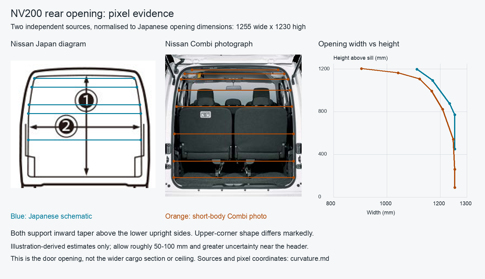

# Likely body curvature and pixel analysis

Research date: 2026-10-16. These are starting estimates for an adjustable model, not fabrication dimensions.

The evidence supports a broad lower cargo section, inward-curving upper sides and a shallow crowned roof with rounded
shoulders. A useful **upper-interior width hypothesis is 1200–1300mm**, with 1250 as a provisional modelling value.
This means the region around the upper rails / roof shoulders, not a universal width at the ceiling's highest point.
Neither the exact height of that section nor the finished plywood ceiling profile has been measured.

## New evidence

### Japanese upper mounting hardware

[Rocky's VM20 van-specific crossbar][rocky] has 1134mm clear width, a 32mm diameter, its underside 1175mm above the floor,
and 110mm from its top to the ceiling. The [annotated installation photo][rocky-photo] shows its position relative to
the upper side rails. Thus the local height implied by those endpoints is about 1317mm, not 1285mm.

That is a useful independent reference, but bar width is not body width. Brackets and rails lie outside its clear span;
the photograph has perspective and does not provide a precise full-width section. It supports the proposed upper-width
range without measuring it. The height also must not be substituted for Nissan's maximum bare-roof height.

[Local annotated source photo](sources/rocky-upper-crossbar.jpg).

### Nissan's insulated van: indirect bounds

[Nissan's work-vehicle brochure][special], printed page 2, supplies 1250mm lined width, 1180mm height and 50mm insulation
on the sides and ceiling. Its schematic upper span is roughly 85–90% of its lower span. Treating that ratio as scale
gives about 1060–1125mm lined upper width, or roughly 1160–1225mm after adding two nominal 50mm layers.

This is **weak corroboration**, not a recovered metal dimension: the sketch is oblique, its edges are not perfectly
parallel, and liners can bridge cavities. Unknown air gaps and profile offsets matter. The printed **1110mm is between
wheel-house enclosures**, not roof width. The enclosures are 770mm long and 245mm high above the raised floor.
Adding the nominal 40mm loading-height difference gives approximately 285mm above a stock floor only if datums match.
It is an enclosure limit, not a bare wheel-house measurement. [Local PDF](sources/nissan-work-vehicles.pdf).

### Bare-metal photographs

A [Japanese owner's April 2010 photographs][owner] show the actual bare surfaces:

- [Ceiling](sources/owner-ceiling.jpg): broad, shallow central crown, transverse ribs, longitudinal channels and
  curved side-to-roof shoulders. Separate roof skin, ribs and finished lining when defining usable clearance.
- [Wheel house](sources/owner-wheelhouse.jpg): a rounded rectangular crown and relatively upright inner face, with
  rounded top edges and fore/aft shoulders. The shape varies across its depth.

These establish shape, not radius or size. Image URLs are [ceiling original][ceiling] and [wheel-house original][arch].

## Rear-opening pixel measurements



The [Japanese aperture schematic][jp-image] is 800 × 240 pixels. We use its clear-opening edges: width reference
x=75–203, and vertical reference y=37–152. With 1255 × 1230mm anchors, horizontal scale is 9.805mm/px and vertical scale
10.696mm/px. Their 9% disagreement means this is not a uniformly scaled engineering drawing.

The second source is the rear photograph on printed page 16 of [Nissan's RHD Combi brochure][combi], hosted in Mauritius
(May 2016 South African material). Its short body and upward hatch make the outline relevant, but trim and market differ.
The extracted image is 320 × 479 pixels. Opening references are x=51–270 and y=128–346. We rescale its opening to the
Japanese anchors independently in X and Z; that transfers a candidate contour, not verified Japanese geometry.

Representative widths after normalisation:

| Height above opening sill | Japanese schematic | Combi photo | Interpretation |
| --- | ---: | ---: | --- |
| Around 500mm | 1255mm | 1250mm | Lower sides nearly upright |
| Around 850mm | 1235mm | 1210mm | Inward taper develops |
| Around 1100mm | 1170mm | 1125mm | Upper pillars noticeably reduce width |
| Around 1200mm | 1110mm | 905mm | Top corners disagree; do not average into a precise curve |

Heights in the table are approximate comparison bands; exact sampled heights differ slightly. See the
[pixel coordinates and calculated values](analysis/aperture-pixels.csv). Values are rounded for reporting.
Allow roughly 50–100mm for a working estimate through the broad profile, with substantially greater uncertainty close
to the header. These allowances are judgment, not statistical confidence intervals.

The photographs and schematic agree on general taper, but the photograph has much more rounded upper corners.
Do not infer the roof width from the rear opening, nor fit one exact circular radius from these pictures.
No perspective correction beyond independent axis normalisation was attempted; missing camera calibration prevents it.

Reproduce the CSV and annotated figure using the existing project environment:

```sh
uv run --locked python docs/research/nv200/analysis/aperture_pixels.py
```

The script records manual edge selections and the calculation `known span × pixel span / reference pixel span`.
It adds no runtime dependency, test machinery or application geometry.

## How this integrates with the model

The shell, rear corners and wheel houses should share the same body reference dimensions and stations. Keep their
existing groups and stable labels, while replacing the simplified shapes inside those groups.

| Existing reference | Treatment informed by this research |
| --- | --- |
| 1500mm cargo width | Maximum envelope reference; do not extend this constant width to the roof |
| Rear corners: 100mm plan radius extruded vertically | Replace with sections varying with height and distance from rear aperture |
| 1220mm wheel-house gap | Retain as a strong Japanese anchor |
| 140mm arch intrusion on each side | Derived from maximum width; revisit against local wall width at the arches |
| 750mm arch length, 280mm height | Plausible provisional envelope; new evidence does not establish exact replacements |
| 200mm arch end radius, no transverse rounding | Replace one-radius simplification with separately adjustable shoulders and crown edges |

The rear-opening deficit `(1500 - 1255) / 2 = 122.5mm` is a useful nominal width comparison. It is not proof of a
122.5mm corner radius: the widest interior and the aperture are different longitudinal sections.

`bench.py` and `cabinet.py` already consume arch bounds and rear-corner allowance. Updating body references must also
keep those clearances coherent. Preserve the furniture layout dimensions; report any newly revealed clash before
redesigning the furniture. The floor outline, walls, roof and rear posts must describe one consistent envelope rather
than overlapping independent guesses.

For the first adjustable body, start the upper-width control at about 1250mm, keep the full 1200–1300 range available,
and use a broad shallow roof profile. Leave crown rise and corner radii explicitly estimated until measured.
Prioritise actual-van measurements at bed height, cabinet-top height, the roof shoulders and wheel-house ends.

## Ceiling cross-beams (roof bows)

The [Japanese owner's bare-roof photo][jp-bows] shows three narrow transverse bows between the rear header and
the cab headlining. See the [saved photograph](sources/japanese-van-roof-bows.jpg). These are curved pressed sections
with flanges and holes, distinct from the longitudinal ribs pressed into the roof skin. This is a 2025 owner report;
the photograph supports the likely arrangement, not verified 2017 positions or part interchangeability.
Its listed 55–130mm measurements concern strips of sound-deadening material across the roof, not bow spacing.

A [Japanese ceiling installation][jp-roof-insulation] reports that 30mm rigid foam fits the roof recesses.
This supports a provisional intrusion on the order of 30mm for clearance modelling, but does not measure the bow's
section, flange depth or changing profile across its span. The [NONIDEL wagon photographs][wagon-roof] show an
additional substantial transverse member associated visually with roof-mounted seat-belt hardware. Do not copy
that wagon detail into the bare-trim van without confirming it on Gert's vehicle.

The [Nissan North American body-builder drawing][nam-bows], printed BBG-152 (PDF page 154), gives dimensions tied
to roof mounting points. The [saved drawing](sources/north-american-roof-bow-drawing.png) was inspected visually:

| Callout | Published dimension | Meaning in the drawing |
| --- | --- | --- |
| A | 790mm | Longitudinal offset from rear striker mounting reference to one roof-bow mounting line |
| B | 420mm | Longitudinal spacing between the two illustrated bow mounting lines |
| C | 617mm | Transverse offset from the side-opening pinch-weld reference to a mounting point |
| D | 98mm | Transverse separation of the paired mounting points; not beam width or vertical depth |

These dimensions belong to the North American body and are not adopted as Japanese model coordinates.
The [2016 repair manual][nam-brm] also identifies itself as NV200 NAM; it does not resolve Japanese applicability.
Nissan's [2017 US specifications][nam-spec] list a 115.2-inch wheelbase (about 2926mm), versus 2725mm for the
Japanese body in the existing research. Subtracting 200mm from arbitrary bow positions is not a justified conversion.

No verified Japanese bow centre positions, fore–aft widths, transverse section dimensions or underside heights
were found. Perspective photos without a longitudinal scale cannot establish those dimensions accurately.
For modelling, keep each bow's position, fore–aft width and vertical intrusion independent, with its transverse
curve following the roof. The rear header and cab header need separate profiles. Measure these before using them
to set cabinet notches or ceiling clearances. The model uses adjustable estimates: Y = 400 / 950 / 1500mm,
80mm fore–aft width, 90mm centre depth and 15mm underside crown rise. With the estimated 75mm bare-roof crown,
that leaves about 30mm depth at the shoulders. These values are a chosen preview, not measurements inferred from
the photos. Gert confirmed that 3mm plywood is attached directly beneath the bows, following their shallow curve;
the model represents that sheet as a solid and fits the cabinet to its underside.

## Source coverage and limitations

- Japanese manufacturer brochures, aftermarket mounting instructions, owner photographs and European short-body
  conversion references were searched. No verified stock transverse body section with all required dimensions emerged.
- The [TRIMAT liner drawing][trimat] does print a 1019mm inside roof width, but it describes a refrigerated insert with
  unknown offsets. That may be the sort of detailed diagram remembered by the user; it is not a stock roof dimension.
- [Owner-reported roof mounting spans][mounts] of about 1120–1125mm concern external fixing points, not interior width.
- North American long-body guides, raised-roof conversions and unverified commercial CAD were not used for numeric fit.
- Images were inspected, measurement arithmetic executed, and the resulting overlay visually checked. The adjustable
  reference envelope described in [CAD model conventions](../../cad-model.md) uses these findings; Gert's van remains
  the source for final fit. Smooth profiles and estimated control values are not measured body sections.

[rocky]: https://www.rocky.ne.jp/series/series-rw/nv200/
[rocky-photo]: https://www.rocky.ne.jp/images/images-rw/RW-12V_img.jpg?20251021=
[special]: https://biz.nissan.co.jp/CATALOG/DATA/nv200vanette_wv.pdf
[owner]: https://iizukakuromaguro.sakura.ne.jp/251_nv200/251_nv200.html
[ceiling]: https://iizukakuromaguro.sakura.ne.jp/251_nv200/R0011037.jpg
[arch]: https://iizukakuromaguro.sakura.ne.jp/251_nv200/R0011040.jpg
[jp-image]: https://www-asia.nissan-cdn.net/content/dam/Nissan/jp/vehicles/nv200vanette/2509/interior/loadability/nv200vanette_2509_interior_loadability_02.jpg
[combi]: https://www.nissan.mu/media/vfrdfgxz/nv200_brochure_rhd_eng.pdf
[trimat]: https://www.trimat-kit.com/media/plan-carrossier-nissan-nv-200-ancien-modele-gb.pdf
[mounts]: https://www.hochdachkombi.de/threads/abstand-der-fixpunkte-fuer-dachzelt.16490/
[jp-bows]: https://minkara.carview.co.jp/userid/181727/car/3698574/8307599/note.aspx
[jp-roof-insulation]: https://vanlifetrip.hatenablog.com/entry/2023/08/18/093111
[wagon-roof]: https://nonidel.jp/heat/17615.html
[nam-bows]: https://pvsheridan.com/2013-Nissan-NV200-Cargo-Van-BBG.pdf#page=154
[nam-brm]: https://drive.google.com/file/d/1AMaYk5-CjiDq2FgpIluzqXc5ozGmgBK3/view
[nam-spec]: https://usa.nissannews.com/en-US/releases/release-1b38e9b884ac49098836a762d5c4652a-us-2017-nissan-nv200-press-kit
