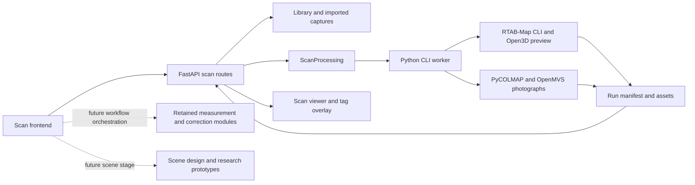
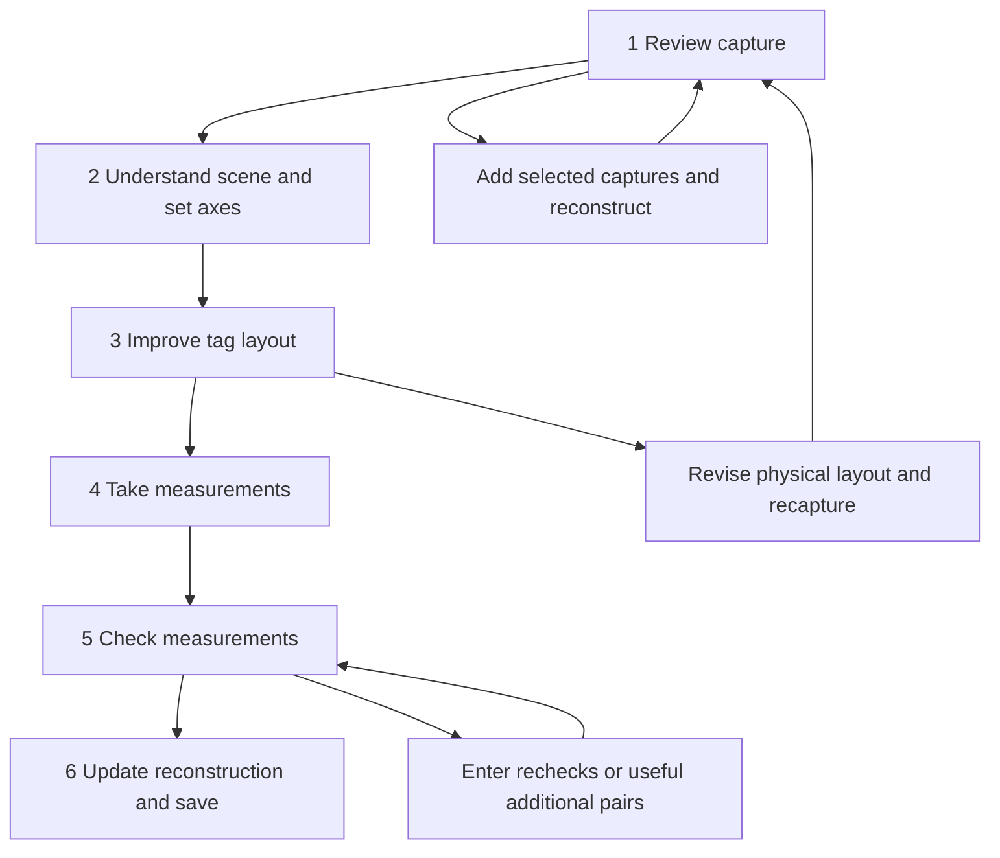

# Scan subsystem architecture and standalone application handoff

This document describes the scan subsystem at commit `91e7945` on `develop`, its approved unfinished workflow,
and the boundaries a separate application must reconsider. It includes the subsequent quality investigation in
the working tree. It documents the existing implementation; it does not select a language, UI toolkit, hardware
platform or reconstruction backend for the new application.

The subsystem imports captures of a van interior, reconstructs geometry and tags, and is intended to guide physical
measurements that improve the reconstruction. It currently lives inside Campervan CAD, but its processing CLI and
numerical modules have no need to execute CAD models.

## 1. Current state and specification authority

**Only capture/reconstruction is connected to the current six-stage workflow UI.** Measurement persistence and
numerical algorithms exist, but the old measurement workflow screens and their orchestration API were removed.
Scene understanding has an approved algorithm design and research scripts, not an integrated application pipeline.

Use these documents in this order when distinguishing current requirements from history:

| Document | Role and status |
| --- | --- |
| [Capture workflow redesign](flow/2026-11-10-capture-workflow-redesign/spec.md) | Latest six-stage specification; original workflow approved 10 November, photographic stage-1 revision approved 11 November |
| [Current stage-1 implementation plan](flow/2026-11-10-capture-workflow-redesign/plan.md) | Implemented photographic reconstruction revision and evidence; not an implementation plan for stages 2–6 |
| [Original stage-1 plan](flow/2026-11-10-capture-workflow-redesign/stage-1-plan.md) | Historical delivery of the database-only review stage and removal of the old workflow |
| [Installed RTAB-Map plan](flow/2026-11-09-embedded-rtabmap/plan.md) | Implemented CLI integration; supersedes the original source-build/Python-binding design in that folder's spec |
| [Measurement workflow spec](flow/2026-11-09-scan-measurement-workflow/spec.md) | Numerical/domain requirements and historical four-stage workflow; navigation is superseded |
| [Scene review spec](flow/2026-11-09-scan-scene-review/spec.md) | Approved scene-understanding scope; automatic-on-import execution and broader editor requirements are superseded |
| [Scene algorithm design](flow/2026-11-09-scan-measurement-workflow/scene-review-design.md) | Explicit recognition, segmentation and geometry proposal; not proof of a delivered pipeline |
| [Shared contracts](flow/2026-11-09-scan-measurement-workflow/shared-contracts.md) | Ownership, physical/semantic separation and interchange; old four-stage composition references are historical |

The latest user decision is to create a separate application. Earlier constraints requiring all scan features to
remain inside the CAD application describe the old integration, not the ownership of that new application. The user
also rejected retaining backward-compatibility and rollback layers for the workflow replacement. Old source paths
and serialized schemas are useful evidence, not a requirement to reproduce every existing mechanism.

Recent suggestions to change fusion or refine a preview mesh against photographs were proposals only. They are
not approved increments. In particular, the current photographic baseline spec explicitly requires photographic
camera reconstruction and dense stereo, and excludes seeding that baseline with a LiDAR mesh.

## 2. Domain model

The distinctions below matter more than current filenames or class names.

| Concept | Meaning and ownership |
| --- | --- |
| Imported capture | An original database or photograph, with a stable ID, content hash, source metadata and owned stored file |
| Capture group | Organizes imported captures and derived results, such as `interior-v1`; it is not a physical coordinate frame or proof that tags stayed fixed |
| Reconstruction/result | Geometry, cameras and detected tags derived from an explicitly selected source set and settings; each processing run has a new identity |
| Physical tag layout | Identifies a physical arrangement and its measurement document; its UUID differs from the group and result IDs |
| Tag observation | Evidence that a printed tag appeared in a particular source image, potentially with corners and a located pose |
| Physical measurement | A user-entered distance between two tag IDs in a layout, with units, original entry text and assumed precision |
| Measurement network | A fitted relative shape inferred from physical distances, with rigidity, consistency and uncertainty diagnostics |
| Reusable scene profile | Versioned context text, target classes, approximate relationships and reference definitions |
| Capture interpretation | Labels, masks, geometric associations and user corrections bound to one capture's evidence |
| Coordinate definition | Instructions identifying axes/origin, reusable where its references still apply |
| Solved alignment | A transform computed for a particular result from that coordinate definition |
| Derived artifact | A report, plan, interpretation or correction tied to input fingerprints and algorithm/settings provenance |

Important invariants:

- Positions belong to a reconstruction. Reusing tag ID 5 does not justify copying its coordinates to another result.
- A group can contain several reconstructions of different selected inputs. Appending inputs creates another result.
- Measurement association follows physical layout identity. A changed layout cannot inherit measurements involving
  moved tags merely because the numeric IDs match.
- Physical measurements remain authoritative user observations. A fit produces separate estimated distances and
  positions; it does not overwrite entered values.
- Scene priors, captured positions and fitted measurements have different evidential roles. They must not become
  duplicate independent measurements of the same thing.
- Library display names can change without changing source filenames, capture IDs or run IDs.

### Units and coordinate conventions

Geometry, camera translations, tag translations and physical ranges use **metres** internally. Voxel and printed-tag
settings often use millimetres at the boundary. Covariance uses square metres; the UI presents relevant distances
and uncertainty in millimetres. CAD models elsewhere in this repository use millimetres.

`poses.json` stores optical **camera-to-world** transforms. OpenCV camera axes are right/down/forward. Projection and
fusion require the inverse transform. Original RTAB-Map graph nodes have their own sensor/node frames; the retained
graph contract includes optical offsets rather than assuming a node pose is already an optical camera pose.

Photographic reconstruction starts at arbitrary scale. Supported tag side lengths establish one uniform scale;
the producer applies it to the reconstruction and cameras. Without support, the result remains explicitly
`arbitrary` and must not offer metric measurements.

`TagAlignment` owns a right-handed `scan_to_reference` transform. The intended van frame has X across, Y from rear
towards cab and Z up. A solved display alignment is separate metadata; it does not deform the source mesh or rewrite
the stored camera poses. Floor-normal up and gravity up need not agree if the van stands on a slope.

## 3. Runtime architecture

The current application uses Python 3.13/FastAPI and a TypeScript/Vite frontend. Browser rendering uses Three.js
objects within the existing viewer infrastructure. CAD and scan tabs share navigation/rendering infrastructure,
but scan geometry arrives as PLY/OBJ assets through HTTP rather than through the Python CAD publication path.

### Code ownership

| Responsibility | Current source |
| --- | --- |
| HTTP composition and result discovery | `src/campervan/api.py` |
| Capture upload, processing request and job routes | `scan_processing_api.py`, `scan_processing.py` |
| Native tool discovery, RTAB export/reprocessing, common publication | `scans.py` |
| Depth-based mesh and baked vertex colour | `scan_reconstruction.py` |
| Original photo decoding, grouping and provenance | `scan_photos.py` |
| SfM, dense photographic reconstruction and publication | `scan_photogrammetry.py` |
| Multiview photographic tag localization and metric scale | `scan_photo_tags.py` |
| Existing photographic texturing adapter | `scan_texturing.py` |
| Library preferences, grouping, moving and deletion | `scan_library.py`, `scan_library_api.py`, `scan_groups.py` |
| Physical layouts and observations | `scan_layouts.py`, `scan_measurements.py`, `scan_measurements_api.py` |
| Range fit, information, relative groups and rigidity | `scan_network.py` |
| Pair selection, placement diagnostics and tape-path evidence | `scan_suggestions.py`, `scan_placement.py`, `scan_visibility.py` |
| Original scan graph, joint correction and RGB-D rebuild | `scan_graph.py`, `scan_analysis.py`, `scan_rebuild.py` |
| Optional reviewed geometry relationships | `scan_context_factors.py` |
| Workflow schemas, fingerprints and retained analysis worker | `scan_workflow_models.py`, `scan_workflows.py`, `scan_analysis_worker.py` |
| Axis/origin definitions and solved transforms | `scan_alignment.py` |
| Viewer, result/layer selection and completion handoff | `frontend/src/scan.ts` |
| Importer, capture manager and processing presentation | `scan-import*.ts`, `scan-library*.ts`, `scan-job-status.ts` |
| Current stage-1 shell | `scan-workflow-panel.ts` |
| Shared panel and selection visuals | `side-panel.ts`, `scan-tags.ts`, shared viewer camera/command code |
| Printable tag PDFs | `src/campervan/apriltags.py`, `frontend/src/apriltags.ts` |

Backend filenames without a directory above live under `src/campervan/`; frontend filenames live under
`frontend/src/`. These are current ownership boundaries, not a proposed package structure for the new app.

## 4. Capture and reconstruction paths that exist today

### Import and source selection

The manager offers `Create quick preview…` and `Create detailed reconstruction…` through the same importer.
File selection uploads originals; processing requires a separate explicit action. The user sees existing and new
sources and chooses the exact cumulative input set. Still photographs may be the first input; a preview is optional.

Supported uploads are `.db`, `.jpg`, `.jpeg`, `.png` and `.heic`. Uploads stream to a temporary file while computing
SHA-256, then validate before promotion. Equal content already stored in the same group returns the existing
capture. Equal basenames from different captures cannot overwrite one another because storage uses capture UUIDs.

The backend checks group membership, duplicate selected IDs, source existence and layout/measurement association.
Preview requests require databases. Photographic requests accept stills, database photographs or an explicit mixture.
The database reader currently accepts schema versions beginning `0.24.`. That is a database-format restriction,
not an assertion that the iOS App Store version number must match it.

### Quick preview: recorded RGB-D

1. Copy selected databases into a new run's working directory.
2. Use `rtabmap-reprocess` when joining sources or detecting markers. Preserve g2o processing and reject disconnected
   sessions rather than reporting a fabricated joined reconstruction.
3. Use `rtabmap-export` to retain RGB, depth, confidence, calibration and optimized optical camera poses.
4. Export original graph observations and saved tag estimates for downstream correction.
5. Mask low-confidence depth pixels and integrate depth into Open3D's tensor TSDF volume.
6. Extract the cloud and full mesh. Save the full mesh before display simplification and component cleanup.
7. Publish a simplified display mesh and baked colour through the common run manifest.

`ScanSettings` defaults include 5 mm voxels, a 25 mm signed-distance truncation band, maximum depth 4 m, confidence
threshold 50 and a 500,000-triangle display target. The UI also offers a coarse 10 mm / 50 mm preview. These describe
processing choices, not metric accuracy. The truncation band is not a Gaussian blur radius.

The current worker forces the new preview action to use baked colour. The older offline CLI also supports
`--texture-mode photo`, which textures an existing depth-derived mesh without reconstructing geometry from images.
That older capability is distinct from the detailed photographic producer.

### Detailed reconstruction: photographic geometry

1. Decode exactly the selected images into full-size working PNGs. Preserve originals, EXIF/ICC metadata and stable
   source-image identities. Normalize orientation. Database photographs use the existing exporter and available
   calibration, without requiring saved poses as a prerequisite for image extraction.
2. Group cameras by available lens/camera/focal/dimension metadata. Missing metadata falls back to a per-image group.
   Database image calibration initializes camera parameters where available.
3. Use PyCOLMAP CPU SIFT extraction, exhaustive matching and geometric verification, then incremental mapping with
   local/global bundle adjustment. Recorded RTAB poses do not substitute for this camera reconstruction.
4. Choose the connected component with the most registered images, breaking ties by sparse-point count and then
   component ID. Record other components and unregistered images.
5. Export the COLMAP model, sparse tracks and undistorted photographs.
6. Detect configured 36h11 tag corners in registered undistorted images and triangulate corresponding corners.
   Reject unsupported geometry with the pinned mapper's reprojection and triangulation-angle criteria. A tag needs
   four supported corners to contribute side lengths to scale. Single-view detections remain inspectable but unlocated.
7. Estimate a uniform scale from the median of valid configured-side/reconstructed-side ratios. Preserve arbitrary
   units when scale is unavailable. Apply any supported axis definition to the new result through the alignment owner.
8. Run OpenMVS `InterfaceCOLMAP`, `DensifyPointCloud`, `ReconstructMesh`, `RefineMesh` and `TextureMesh`.
9. Retain the refined full mesh as master; simplify a separate viewer copy. Publish geometry, photographic texture,
   cameras, source mappings, tag support and scale provenance.

The current implementation caps supported stages at four CPU threads. Dense reconstruction uses resolution level 0
and a maximum resolution covering the actual undistorted image sizes. It does not introduce CUDA or remote execution.
OpenMVS commands use compressed scene archives; that setting does not compress its depth-map files.

This pipeline is implemented and produced a useful 51-photo baseline. It has not demonstrated satisfactory whole-van
throughput/resource behavior: a 1,037-photo run failed during densification and the user requested deletion of its
generated data. The small baseline is not evidence that a large run will fit available time or disk.

### Tag localization and scale are separate from tape fitting

Photographic tag localization uses exact reconstructed cameras and ordered image corners. OpenCV pixel centres
and COLMAP pixel centres differ by 0.5 pixels; the adapter accounts for that convention. It does not mix metre-valued
single-view PnP estimates into an arbitrary-scale SfM reconstruction.

Printed tag size establishes a scale reference, not verified mesh accuracy. Capture processing does not solve the
physical tape network or silently change any saved distance.

## 5. Persistent data and interchange

### Current storage layout

~~~text
data/
  scan-library.json                       presentation/group preferences and revision
  scan-captures/<capture-id>/
    capture.json                         identity, group, filename, hash, source metadata
    <original filename>                  owned original capture bytes
  scan-tag-layouts/<layout-id>/
    layout.json                          name, tag family and printed size
    measurements.json                    authoritative distances, sigmas, exclusions, revision
  scan-measurements.json                  retained older measurement-store path
  scan-workflows.json                     retained workflow/profile/binding store
  scan-alignment.json                     an explicit reusable reference definition

.local/
  scan-jobs/<job-id>.json                 request snapshot, state, result reference
  scan-jobs/<job-id>.log                  worker stdout/stderr
  scans/<run-id>/
    run.json                             published result manifest
    frames.json                          source RGB/depth/calibration associations
    poses.json                           optical camera-to-world transforms
    graph.json                           retained original RTAB graph, where applicable
    request.json                         selected inputs/settings, where produced
    image_sources.json                   photographic source mapping
    tag-support.json                     photographic detections and supported tracks
    processing.log                       native commands/stage diagnostics
    cloud.ply
    mesh.ply                             display mesh
    working/full-mesh.ply                 full geometry master
    photo/                               OBJ, MTL and photographic texture files
    working/                             native databases/models/images/intermediates
~~~

Not every run has every file. Photographic `frames.json` describes photographic cameras/images; it does not provide
the original-depth PNG contract expected by RGB-D-only consumers. `graph.json` describes RTAB observations, not a
universal representation of COLMAP feature tracks. Retained workflow/analysis code uses additional request and
artifact directories; its orchestration is not connected to the current UI.

Some source mappings contain absolute paths as well as stable capture IDs. Moving a project directory therefore
requires deliberate path handling. Copying one mesh file does not preserve the capture's provenance or ability to
reconstruct, interpret, measure and correct it.

### Result contract

`run.json` publishes the result after geometry is available. Relevant fields include:

| Field | Consumer meaning |
| --- | --- |
| `schema_version`, `created_at`, `name` | Result format and producer metadata |
| `purpose` | `preview` or `photographic` for current import-produced results |
| `units`, `scale` | Metric versus arbitrary geometry and the evidence for scale |
| `inputs`, `settings`, `stages_seconds`, version provenance | Exact source set and processing decisions |
| `tag_layout_id`, `tags` | Physical measurement association and this result's located tags |
| `alignment` | Accepted definition, solved transform or explicit unaligned reason |
| `geometry`, `frames` | Counts and reconstruction summary, not accuracy certification |
| `layers` | User-visible layer IDs, asset paths and kinds (`cloud`, `mesh`, `obj`) |
| `assets` | Allowlisted files the asset API may serve |
| `photo_reconstruction` | Registered/unregistered images, components, tag support and settings |
| `photo_error` | Geometry exists but photographic texturing failed |
| `source_run_id`, correction provenance where present | Derived-result lineage |

The API discovers the retained full-mesh asset and adds a full-resolution layer when it exists. Shaded variants
share geometry with the corresponding coloured PLY layer; their materials change lighting, not vertex positions.
Photographic geometry-only PLYs are not exposed as if they contained RGB colours. Their photographic appearance
comes from the OBJ/material/texture assets.

### Measurements and revisions

`MeasurementDocument` is version 1 with layout ID, optimistic revision, canonical unique tag pairs, default sigma
and excluded pairs. A distance records `tag_a`, `tag_b`, `distance_m`, `entered_text`, `source_run_id` and optional
`sigma_m`. Save/delete/configure operations increment the revision and replace the JSON file atomically under a lock.
These observations are editable records, not an append-only immutable history. Workers receive snapshots.

Library and retained workflow stores also use revisions and temporary-file replacement. Multi-file changes and
directory deletion are not database transactions. An interrupted deletion can leave partial filesystem effects.

## 6. API, CLI and job lifecycle

### Active HTTP surface

All routes below are relative to `/api/v1`:

| Route | Contract |
| --- | --- |
| `GET /scans` | Discover results and decorate them with library preferences |
| `GET /scans/runs/{run_id}/assets/{path}` | Serve a contained, allowlisted result asset |
| `GET /scans/{filename}` | Serve the older standalone PLY preview form |
| `GET`, `PUT /scans/library` | Read/save revisioned library preferences |
| `DELETE /scans/library/result` | Delete a named result with expected library revision |
| `DELETE /scans/library/group` | Delete an owned capture group and its data with expected revision |
| `POST /scans/library/move` | Move an imported capture or result family between groups |
| `GET /scans/imports` | Imported captures, tag layouts and reconstruction jobs |
| `POST /scans/captures?group_id=…&filename=…` | Stream raw upload bytes; return capture metadata |
| `POST /scans/layouts` | Create tag settings and an independent measurement document |
| `POST /scans/process` | Start an explicitly selected preview/photographic reconstruction; HTTP 202 |
| `GET /scans/process/{job_id}` | Current state, stage, available native percentage and log tail |
| `POST /scans/process/{job_id}/cancel` | Cancel the active worker and descendants |
| `GET /scans/measurements` | Read observations for a layout |
| `PUT /scans/measurements/settings` | Save measurement precision/settings with revision |
| `PUT`, `DELETE /scans/measurements/{tag_a}/{tag_b}` | Save/remove an observation with layout and revision checks |

Processing requests are discriminated by `purpose` and contain `group_id`, selected `capture_ids`, `layout_id`,
`name`, settings and an optional alignment definition. The producer snapshots resolved capture metadata and source
paths before launching work. Measurement entry additionally validates that its selected source result contains
both tags. Revision conflicts use HTTP 409; invalid requests use 422.

There is **no active workflow/scene/analysis orchestration API** in this checkout. The presence of numerical worker
commands and schemas must not be mistaken for mounted routes or working six-stage navigation.

### Offline commands

~~~sh
uv run --locked --extra scan campervan scan process INPUT.db \
  --output NEW_RUN_DIRECTORY --voxel-mm 5

uv run --locked --no-sync campervan scan reconstruct \
  --request JOB_JSON_WITH_REQUEST_FIELD --output NEW_RUN_DIRECTORY

uv run --locked --extra scan campervan scan align RUN_DIRECTORY \
  --alignment ALIGNMENT_DEFINITION_JSON
~~~

The photographic CLI reads the nested `request` object from a job JSON file. These commands do not require CAD
model execution or the browser. They are current command contracts, not a requirement for the standalone app's UI.

### Processing lifecycle and failure ownership

`ScanProcessing` owns one active expensive task in the application process. It starts a separate Python CLI worker
in a new process session; the worker invokes native executables. A frontend singleton polls status and shows the
same cancellation, error and log UI across capture actions.

States are `processing`, `completed`, `failed`, `cancelled` and `interrupted`. There is no durable queue or automatic
resume engine. The API owns the task handles; shutting it down or triggering development autoreload interrupts
processing. Closing the import/progress dialog does not cancel it. Cancellation kills the worker process group.

Progress comes from printed stage labels and selected native percentage lines. It is not a reliable whole-pipeline
time estimate. Some stages remain indeterminate even when their logs contain more detailed counts.

The worker publishes a result reference when a `run.json` exists. A texture failure can therefore leave an
inspectable geometry result while the job remains failed and reports the texture error. Other native failures can
leave only working files and logs. Retaining intermediates is not the same as implementing resume: explicit retry
currently creates a new run and may repeat completed work.

Sources and earlier results survive ordinary processing failure. Group deletion is a separate explicit destructive
operation: it deletes the group's owned imported files, generated result families and processing history. It retains
measurement/layout documents and external source files outside the app's capture storage. Result deletion removes
that generated output. Archive only changes visibility. Moving a correction family preserves its source relationship.

## 7. The approved six-stage user process

The intended process is sequential but permits explicit best-effort continuation. Uncertainty, incomplete
measurements and absent scene interpretation are advisory limitations, not artificial navigation gates. Missing
source assets and failed processing remain real errors.

### Stage 1: Review capture

Implemented entry stage. Inspect geometry and detected tags, select quick preview or detailed reconstruction, and
add more selected sources when needed. The user judges visible gaps. Automatic completeness scores, coverage
heatmaps and invented minimum observation counts were explicitly removed from this stage's scope.

The economical intended capture sequence is a quick initial scan for spatial/tag-layout work, followed by detailed
overlapping still photographs once placement is settled. Original photographs can also be the first input.

### Stage 2: Understand the scene and establish coordinates

Approved, not implemented in the app. `Analyse scene` explicitly runs recognition. Display understood regions and
objects linked to their original images and 3D support. Allow relabeling, boundary correction and dismissal through
one editor. Save additional guidance without starting inference; `Reanalyse scene` explicitly uses it and records
the guidance/profile revision. Preserve user corrections on reanalysis.

After scene review, propose axes and an origin from supported geometry and tag references. Resolve front/back from
evidence or user confirmation and apply the frame explicitly. Preserve an accepted frame when reanalysis changes
its proposal; present the discrepancy for review. Allow the user to change axes/origin and compensate the camera
so applying a display frame does not jump the view.

### Stage 3: Improve tag layout

Approved, not implemented as a workflow stage. Assess whether the arrangement can yield a rigid relative shape
with reasonable measuring effort and predicted precision. Show assumptions first: default target 5 mm, tape sigma
3 mm (one standard deviation), required spatial coverage and tape access.

The primary score is the measurement count of the planner's smallest found target-reaching plan, labelled
`Proposed minimum`, alongside predicted worst-tag uncertainty. This is an engineering search result, not a proof
of a global combinatorial optimum or mesh accuracy.

Compare layouts from an **empty hypothetical distance graph** at captured tag positions. Existing tape work must
not make one layout score better. Evaluate single supported additions/moves and individual removals under comparable
coverage/precision assumptions; do not recursively search every layout combination. Extra tags are unknowns,
not exact anchors. Proposed mounting points require observed fixed-body surface support, not floating coordinates
or generic per-tag advice. Explain keep/move/add/remove findings and their predicted measuring consequence.

If the user moves tags and recaptures, create a new layout identity and copy only measurements between tags declared
unchanged. The capture revision intentionally does not add a per-import layout/motion-detection gate.

### Stage 4: Take measurements

Approved, not implemented in the current UI. Open on a generated pair checklist with inline distance entry. Planning
and entry are one stage. Seed remaining-work planning with existing applicable measurements; this differs from the
empty-graph layout score in stage 3.

Rows show pair IDs, a clearly labelled captured estimate, units, access status and save/error state. Selecting a row
highlights that pair. The user need not select two tags before entering a suggested distance. Reuse the same editor
for initial measurements, extras and rechecks. Enter saves then advances after acknowledgement; Escape restores
the saved value; drafts survive save failures and poll updates. Numeric input must not trigger viewer shortcuts.

`Cannot measure this pair…` records an obstruction and offers replanning without discarding saved observations or
reordering the checklist during editing. Partial data can proceed to checking.

### Stage 5: Check measurements

Approved, with retained solver foundations. Explicitly calculate a physical **range-only** network. Captured
coordinates initialize the fit and display handedness; floor, symmetry and captured-position priors do not supply
missing physical constraints.

Report three separate conclusions: distance consistency, rigidity/ambiguity and predicted precision. A flexible or
just-constrained network can fit erroneous distances with small residuals. Rank suspect observations by absolute
standardized residual; the existing review threshold is greater than 2. Show entered and fitted distances,
`fitted − entered`, sigma and robust downweighting without replacing observations or declaring a unique culprit
when evidence only establishes a coupled conflict.

Show **all additional pairs with meaningful benefit**, using the shared planner and access assessment, rather than
an arbitrary top-N list. Distinguish each pair's gain against the current baseline from the sequential recommended
batch; overlapping benefits are not additive. Remeasure or add rows here, then explicitly recalculate.

### Stage 6: Update reconstruction and save

Approved, with retained RGB-D correction foundations. Preview the alignment of the fitted relative shape to the
captured tags, then solve the original scan graph jointly with each original physical range once. Fitted tag
positions must not be inserted as additional independent observations of those same ranges.

Show movements and residuals before the explicit rebuild. Rebuild from corrected cameras and original capture
evidence, then save a new result in the same capture group. Mark completion only after save succeeds. Axes display
and geometry correction remain separate operations. Underconstrained physical networks may proceed using scan
evidence, with that dependence explained.

**Unresolved architectural seam:** the retained rebuild consumes original RGB-D and an RTAB graph. It cannot silently
correct a photographic result by reverting to LiDAR geometry. The capture spec explicitly leaves photographic
correction for future stage-6 planning. Scene association has a similar RGB-D dependency to resolve for photo-only
results.

## 8. Delivery increments and actual availability

| Increment | State in this repository | Remaining boundary |
| --- | --- | --- |
| Installed native RTAB-Map CLI integration | Implemented; current adapter uses the official installed app | Historical source-build spec does not apply |
| Original stage 1: database reconstruction/review shell | Delivered; replaced old four-stage UI | Its plan is historical after photographic revision |
| Revised stage 1: previews plus photographic reconstruction | Implemented and exercised on a small photo baseline | Whole-capture quality/resource issues remain; UI presence is not quality acceptance |
| Stage 2: explicit scene analysis, correction, axes/origin | Specification and prototypes only | No complete producer, editor or active orchestration |
| Stage 3: tag-layout improvement | Retained numeric components plus latest stage spec | Comparable score/candidate workflow not integrated |
| Stage 4: checklist and measurement entry | Measurement CRUD persists | Current checklist/editor/tape workflow absent |
| Stage 5: physical network checking and suggestions | Retained solvers/worker/artifact contracts | No current stage UI or orchestration API |
| Stage 6: correction preview, rebuild, save | Retained RGB-D numerical/rebuild components | Workflow integration and photographic correction unresolved |

The approved delivery rule is one stage at a time, with its implementation plan in the same capture-workflow Flow
folder and user visual review before planning the next stage. No stage-2-through-6 implementation plans were found
there. Earlier four-stage implementation notes are historical evidence, not a completion claim for the replacement.

## 9. Retained measurement and correction algorithms

These modules are useful extraction candidates. Their current existence does not establish a working user journey.

### Physical fit, rigidity and uncertainty

`scan_network.py` uses GTSAM Point3 variables and one robust range factor per entered pair. Effective sigma comes
from the pair override or document default. The fit uses Huber parameter 1.345 and Levenberg–Marquardt with QR.
Deterministic gauge constraints remove whole-shape position/orientation without turning captured tag positions into
precision observations.

Information analysis projects whitened range Jacobians into the complement of global rigid motion. It retains
disconnected/internal flexible modes. A singular physical shape does not get falsely bounded uncertainty from a
pseudoinverse. Per-tag uncertainty uses 95% positional ellipsoid semi-axes; it is not simultaneous whole-network
95% coverage or mesh accuracy.

The code distinguishes local rank, conditioning, redundancy, actual 3D geometry and generic global uniqueness.
PyRigi provides a bounded randomized global-rigidity check; necessary degree/edge counts are screens, not proofs.
Relative constrained groups can overlap and hinge. Their internal shape precision does not establish their placement
in the whole van. Conditional per-tag directional coverage is a separate diagnostic from observation count.

### Pair planning, layout assessment and access

`scan_suggestions.py` shares range Jacobians, free-network information and covariance updates across initial and
additional planning. It addresses component connection/flexible modes before precision gains, recomputes marginal
benefits after additions, and reverse-deletes proposed edges while retaining the target. It performs a final bounded
topology check rather than invoking expensive symbolic checks for every candidate pair.

`scan_placement.py` inspects captured geometry and optional reviewed mounting candidates. PCA extents describe the
point arrangement; they do not recognize vehicle axes or establish sensor accuracy. The latest empty-graph layout
score and candidate comparison requirements remain integration work.

`scan_visibility.py` distinguishes `obstructed`, `no_obstruction_detected` and `unknown`. It uses finite offset rays
and original-depth support. Mesh holes do not prove a clear path; camera visibility does not prove practical tape
or hand access. User exclusions and access confirmation remain separate from geometry inference.

### Joint scan correction

`scan_graph.py` retains original node poses, links/information, gravity data and optical offsets. It rejects invalid
or unsupported graph observations and does not recreate a missing original graph from already-corrected poses.

`scan_analysis.py` registers an identifiable measured shape with a proper rigid transform, without scale, and then
uses GTSAM Pose3 variables for the original scan graph. Each original tape range enters once. If the independent
network cannot define its shape, the result remains labelled scan-dependent rather than claiming physical-only
accuracy.

`scan_context_factors.py` can add explicitly reviewed geometry relationships to joint correction. It refits original
pixel/depth support under current camera poses. It must not reuse old fitted XYZ samples as independent measured
surfaces. This optional retained capability is broader than the latest stage-6 delivery scope.

`scan_rebuild.py` checks fingerprints, identities and solution hashes before creating a new run, applies reviewed
source-pixel exclusions, writes corrected poses, and reuses RGB-D publication. It preserves original observations.

## 10. Scene understanding design and its limits

The selected design uses target-directed full-photo interpretation, segmentation and multiview geometric checking:

1. Qwen3.5-9B MLX 4-bit proposes target features and image evidence.
2. SAM2.1 Hiera tiny refines target masks.
3. Calibrated RGB-D projection and Open3D geometry associate supported observations across views.
4. One bounded model reconciliation considers geometric/structural conflicts, followed by another geometry check.
5. The user inspects and corrects the result through linked photo/3D evidence.

The scene design records pinned model revisions and `mlx-vlm==0.7.12`, SAM model revision and Transformers/PyTorch
trial choices. These are selected design/trial dependencies, **not installed production dependencies declared by
the project's `scan` extra**. MLX also makes the proposed inference runtime Mac-specific. A different hardware
backend is a decision for the separate app.

Target classes are floor, ceiling, wall, wheel well, window and seat. Uncertain/not observed are statuses, not extra
object categories. Cab/front is a spatial role. Reusable profiles contain editable context text and structured
classes, approximate relationships/tolerances and tag references. Per-capture bindings contain original frame/pixel
masks, supported 3D associations, feature identities and authoritative user corrections.

Priors such as opposing wheel wells, approximate wall symmetry and floor/ceiling relationships guide interpretation.
They do not manufacture missing objects or dimensions, flatten real vehicle taper, or become physical tape
observations. A window may have image-only support: depth measured behind glass does not locate the glass plane.

Experiments live under
`docs/flow/2026-11-09-scan-measurement-workflow/spike/`. They include VLM proposals, segmentation, RGB-D projection
and earlier class-agnostic region approaches. Reports include both successful feature proposals and false labels.
The target mask/multiview pipeline and correction editor are not integrated. Model caches and trial outputs under
`.local/` are not a packaged runtime or proof that inference is ready on another machine.

The latest stage-2 scope requires explicit Analyse/Reanalyse, editable guidance and corrections. It excludes a
general annotation/merge/split editor, automatic cleanup, new recognition-model evaluation and automatic CAD creation.
Older, broader scene documents should not silently expand that increment.

## 11. Shared UX and state ownership

`side-panel.ts` owns one nonmodal panel shell: title/context/actions/status/body/footer, X, Escape, focus restoration
and one active panel. Clicking outside leaves it open. Content-specific panels should not implement their own
dismissal behavior. The intended later editor consumes Escape before it reaches the panel.

The viewer owns camera/projection and result/layer state. Changing a report, stage, selection or result should not
reset framing. Perspective is the default for a new view; explicit Fit reframes. Selection uses one highlight owner,
distinct from green/yellow/red quality status; repeat selection deselects. Findings should highlight relevant tags,
edges, triangles or regions through that owner. Text stays selectable and input focus suppresses viewer shortcuts.

The capture completion handler only auto-opens a result if the user has not navigated or interacted elsewhere;
otherwise it announces completion with an explicit review action. Reload remembers result/layer preferences;
library default selection is a separate fresh-tab preference.

The intended workflow store owns stage decisions, reusable profile references, source interpretation, accepted axes,
plans and artifact references. Physical observations remain in their independent store. Content fingerprints decide
freshness; optimistic revisions protect edits. New capture data invalidates source-dependent interpretations and
corrections without inherently invalidating a physical-only fit. Stale artifacts remain inspectable with reasons;
stale correction application must fail.

The current retained schemas include these concepts but lack a complete mounted workflow. A new app should not
copy generic artifact payloads or leftover legacy-store support merely to preserve this checkout's implementation.

## 12. Dependencies, packaging and operational boundaries

| Component | Current use |
| --- | --- |
| Python 3.13 via uv | Backend, CLI and numerical coordination |
| FastAPI/Pydantic/Uvicorn | Local HTTP contracts, validation and application lifecycle |
| OpenCV headless | Image/calibration handling and AprilTag 36h11 detection |
| Open3D 0.20.0 | RGB-D fusion, meshes, geometry operations and retained visibility code |
| GTSAM 4.3.0 | Physical range fit and original-observation graph correction |
| NumPy 2.5.4 / SciPy 1.18.1 | Numerical operations, covariance and registration helpers |
| PyRigi 1.3.0 | Generic global-rigidity certification |
| PyCOLMAP 4.2.1 | Photographic feature matching, camera reconstruction, triangulation and bundle adjustment |
| pillow-heif 1.8.1 / Pillow | Original HEIC and photo decoding/metadata handling |
| RTAB-Map 0.24.2 installed app | Native database export, session reprocessing, marker and graph semantics |
| OpenMVS 2.4.0 prebuilt tools | Photographic dense stereo, meshing, refinement and texturing |
| TypeScript, Vite and Three.js | Current web UI and scan rendering |

The source of pinned Python dependencies is `pyproject.toml`/`uv.lock`; frontend dependencies are in
`frontend/package.json`. Existing test-related dependency/script entries are not permission to recreate or run tests;
the repository's current `AGENTS.md` forbids them.

Native RTAB discovery defaults to `/Applications/RTABMap.app/Contents/bin` on macOS. Optional
`CAMPERVAN_RTABMAP_BIN_DIR` selects another directory containing both exporter and reprocessor. An explicit path is
authoritative. Non-macOS default discovery uses PATH; cross-platform runtime behavior is not demonstrated.

The adapter supplies `Contents/Frameworks` via child-process `DYLD_LIBRARY_PATH`/`DYLD_FRAMEWORK_PATH` for the intact
official macOS app bundle. The selected integration requires neither Homebrew nor compiling a replacement dependency
tree. The older folder name “embedded RTAB-Map” must not be read as an implemented in-process binding.

OpenMVS discovery checks PATH, then `.local/tools/openmvs-2.4.0`. This is a separate native-tool resolver, not a general
packaging system. Its AGPL licensing and the other components' notices need explicit consideration in the new app's
distribution design; this document does not make a licensing determination.

The current application uses local development ports 5173 (UI), 8000 (API) and 3939 (OCP viewer connection). The scan
CLI itself does not require those services. Logs for running development services live in `logs/`; each scan also
retains its worker and native logs. Do not start services merely to inspect or migrate source/data.

Portability work includes more than choosing executable paths: current process-group cancellation uses Unix APIs,
rigidity checks use a Unix timer, recognition design uses MLX, and source mappings include filesystem paths.
Python packaging and native binaries also need target-platform support. The user's Windows/RTX 3080 machine is a
possible new target, not an implemented remote worker or GPU backend in this repository.

## 13. Known quality and resource failures to carry into the new design

The [capture-quality investigation](research/2026-11-11-depth-quality-cause.md) records the data and methods. It is
important to preserve its limits instead of turning a local diagnostic into a universal sensor specification.

- Original depth in the inspected phone databases is 192 × 256; photographs are 720 × 960. Fine photographic
  appearance does not imply that those depth maps contain equally detailed geometry.
- All 1,144 original depth blobs survived the inspected merge byte-for-byte. Export retained dimensions and changed
  values by less than 1 mm through integer-millimetre conversion. Broad rounding predates those downstream operations.
- Our RGB-D implementation resizes photographs to depth dimensions before colour fusion, retaining 7.11% as many
  pixels. Baked vertex colour cannot recover the original photographs' detail.
- Recorded views disagree geometrically. Multi-view fusion changes sampled surfaces more than single-view
  meshing does. Those differences are not independent physical ground truth; they combine depth, calibration and
  pose effects. Smaller voxels alone do not repair inconsistent evidence or recover missing source relief.
- “Full resolution” in the viewer means the producer's unsimplified mesh, not full photographic resolution or
  certified accuracy. The shaded and coloured views share the same geometry.
- The photographic implementation extracts features one camera group at a time. Database photographs often create
  one-image groups, leaving extraction workers idle. A batching improvement was investigated but not implemented.
- Exhaustive matching considers 537,166 image pairs for 1,037 photographs. No more efficient matcher was delivered.
- The failed large photographic run accumulated about 26 GB, primarily native depth intermediates. OpenMVS 2.4
  retains old and replacement depth-map sets through geometric-consistency passes. `--remove-dmaps` is not enabled;
  its after-fusion cleanup would reduce retained storage but would not prevent that earlier two-set peak.
- There is no disk-space budget, automatic scratch cleanup policy or supported per-stage resume in the app.
  Merely preserving working files does not protect the next run from filling the disk or repeating work.

The user requested deletion of the failed large run, and it was removed. Reports about that run are historical
evidence; its working files must not be assumed present. Current cached experimental outputs are not dependencies
the separate application can rely on finding.

## 14. What to preserve and what the new application must decide

### Preserve the information, not the old UI or process shape

Transfer irreplaceable original captures, printed-tag definitions/sizes, layout IDs, entered physical distances
and their precision/units, source associations and accepted coordinate definitions. Preserve useful generated
results with their manifests, cameras, calibration, graph/feature observations, scale, lineage and supporting image
identities. A mesh-only export is sufficient for viewing, not for the planned measurement/correction workflow.

Keep the conceptual separations between capture, physical observations, interpretation, fitted network and corrected
result. They remain useful whether the new application uses Python, Rust, Go, C++ or another stack.

### Current CAD coupling to remove or replace

- FastAPI composition constructs scan stores beside the CAD project path. Scan runtime settings live in the shared
  settings object.
- The frontend attaches scan UI, panels, navigation, commands and overlays to the existing application/viewer shell.
- Relative `.local/scans` paths and repository data directories assume the current working directory/project layout.
- Job ownership follows the API process, including development autoreload, rather than an independent application
  document lifecycle.

The processing CLI already runs without CAD model execution. Numerical algorithms mostly consume typed documents,
arrays and run directories. These are useful separation seams, though current modules still import shared paths and
helpers from `scans.py` and settings. There is no existing standalone scanner package to copy unchanged.

### Decisions still open for the separate app

1. **Acquisition and geometry:** which phone capture API/app supplies the evidence, which geometry backend owns
   detailed reconstruction, and how it uses photographs, recorded depth and pose estimates without confusing their
   accuracy or provenance.
2. **Runtime and platform:** local native/web/cross-platform UI, packaging, CPU/GPU use and the role of the Windows
   machine. Existing Mac choices do not settle these questions.
3. **Photographic later-stage support:** how scene associations, visibility, original-observation correction and
   rebuilding work for photo-only results. Current RGB-D consumers do not answer this.
4. **Data ownership and interchange:** the new project format and asset location strategy, including how CAD receives
   a selected scaled/aligned result. No new-app/CAD interchange protocol has been approved.
5. **Resource and recovery behavior:** source preservation, cancellable processing, scratch-space limits, cleanup,
   resumable work and truthful progress. The current failed-run behavior is not an acceptable default to inherit.

These are design decisions for the new application, not additional implementation tasks authorized by this document.

## 15. Source coverage and validation limits

This document comes from the current source and the linked approved specifications/plans. The audit covered import,
native adapters, both reconstruction producers, result publication, library/group operations, active APIs, frontend
panels/viewer/job presentation, measurement storage, numerical/visibility/correction modules and scene research.
Current source takes precedence when historical implementation notes describe removed screens or APIs.

The related research report supplies the recorded capture-quality diagnostics. No reconstruction, model download,
service start, test suite, frontend build or browser interaction was needed to write this architecture document.
Source inspection establishes implementation and contracts; it does not certify measurement accuracy, model
recognition quality, large-run throughput, cross-platform portability or visual acceptance of unfinished stages.
